# Alder AP Agent

An agent that validates a restaurant chain's supplier invoices before payment, and pauses to ask for human approval on risky cases, instead of either auto-approving everything or sending every invoice through full manual review.

## The problem

**Alder Kitchens**, a restaurant chain, receives weekly invoices from its food suppliers (meat, fish, vegetables, drinks) to check against a purchase order before payment. Two naive approaches fail:

- **Auto-approve everything**: an unlisted supplier, a duplicate invoice, or an abnormal amount go through unchecked.
- **Send everything to a human**: most invoices are compliant, and burying the real risky cases inside a systematic review queue makes them easier to miss.

The industry adds a complication: a price discrepancy on a fresh product (seasonality, raw material prices) can be perfectly legitimate. Risk isn't binary: a fixed threshold isn't enough, it needs judgment.

## What the agent does

A 6-node [LangGraph](https://github.com/langchain-ai/langgraph) graph:

| Node | Type | Role |
|---|---|---|
| `extract_invoice` | LLM | Extracts structured data from a free-text invoice (supplier, purchase order, line items, amount) |
| `validate_po` | deterministic | Compares the extraction to the purchase order: supplier on file, quantity/price discrepancies, duplicate, amount above threshold |
| `score_risk` | LLM | Judges the severity of the raw discrepancies: a price gap alone isn't necessarily serious, but combined with another signal it often is |
| `auto_approve` / `human_approval` | conditional routing | Low risk → automatic approval. High risk → the graph **pauses** (`interrupt()`) and waits for a human decision |
| `notify` | deterministic | Records the final decision (prints it, and appends it to an audit trail, see below) |

```mermaid
graph TD
    START(("START")) --> EI["extract_invoice"]
    EI --> VP["validate_po"]
    VP --> SR["score_risk"]
    SR -- low risk --> AA["auto_approve"]
    SR -- high risk --> HA["human_approval"]
    AA --> N["notify"]
    HA --> N
    N --> END(("END"))
```



## Real example

```
→ Invoice from Primeur Rhône, 45 kg of tomatoes at €4.80/kg
  (purchase order: 30 kg at €3.20/kg)

← validate_po detects both a quantity discrepancy (+50%) AND a price
  discrepancy (+50%)
  score_risk: "either discrepancy alone could be legitimate, but the
  combination of both is a serious signal" → high risk
  → the graph pauses, waiting for a human decision
  → approved: "price increase confirmed by the supplier (tomato
  shortage), extra quantity needed for the weekend event"
```

When execution resumes after an interruption, it picks up exactly where it left off (LangGraph checkpointer, indexed by `thread_id`), not a fresh run from scratch.

## Audit trail

Every invoice processed by `notify` appends one line to `audit_log.jsonl`, append-only, never rewritten. Real record from the tomato case above:

```json
{
  "timestamp": "2026-10-20T05:36:24.649643+00:00",
  "po_number": "BC-2026-0920",
  "supplier": "Primeur Rhône",
  "restaurant": "Alder Kitchens - Lyon Part-Dieu",
  "total_amount": 247.5,
  "discrepancies": [
    "Quantity discrepancy on 'Tomates grappe': 45.0 kg invoiced vs 30 kg ordered.",
    "Price discrepancy on 'Tomates grappe': €4.8/kg invoiced vs €3.2/kg on the purchase order."
  ],
  "risk": "high",
  "risk_rationale": "The invoice shows a significant quantity discrepancy (45 kg invoiced vs 30 kg ordered, representing a 50% overcharge) combined with a substantial price increase (€4.8/kg vs €3.2/kg, a 50% markup). While individual price variations on fresh products can be legitimate due to seasonality, the combination of both a large quantity discrepancy AND a significant price increase on the same item signals potential billing error or fraud. The total overcharge on this line alone is approximately €108, which is substantial relative to the €247.5 invoice total. This warrants investigation before payment.",
  "final_decision": "approved by human validation",
  "human_comment": "Price increase confirmed by the supplier (tomato shortage), extra quantity needed for the weekend event.",
  "pennylane_invoice_id": 9
}
```

Field names are translated here for readability. `discrepancies` and `risk_rationale` are written directly in English by the code and the model respectively; `final_decision` and `human_comment` still reflect the test harness's own wording, same as the rest of the codebase's comments and docstrings.

## Stack

Python · [LangGraph](https://github.com/langchain-ai/langgraph) (orchestration, state, interrupt/resume) · [langchain-aws](https://github.com/langchain-ai/langchain-aws) (`ChatBedrockConverse`) · Amazon Bedrock (Claude Haiku 4.5) · AWS Bedrock AgentCore (Runtime, Gateway, deployment in progress)

## Evals

`src/evals.py` checks by assertion what the graph actually produced for each case (risk level, final decision, audit record), not a human reading printed text. 6/6 cases pass, including a regression case that replays a prompt injection smuggled into the supplier's name (see `test_adversarial_injection_v3.py` for the original, narrated version of that attack).

## Status

- **Phase 0**: local LangGraph graph, conditional routing and human interruption validated on 6 test cases (compliant, unlisted supplier, quantity/price discrepancy, duplicate, amount above threshold, adversarial injection), plus an assertion-based eval suite and an append-only audit trail. ✅
- **Phase 1**: AgentCore deployment, replacing the in-memory checkpointer with durable persistence, then packaging for AgentCore Runtime. In progress.
- **Phase 2**: AgentCore's native Observability & Evaluations, instead of the homemade traces file and eval suite above.
- **Phase 3**: to be defined based on what's still missing after the first three phases.

Follow-up to [novasupply-agent](https://github.com/UlysseLeb/novasupply-agent), where the agent decided on its own (no human validation step) on a different AWS stack (Strands, Lambda, CDK).
